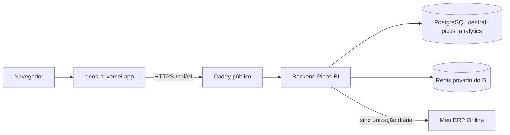

> Atualização de 08/10/2026: telas de urgência de estoque e contas a receber publicadas; catálogo retorna apenas ativos. Consulte [regras, testes, deploy e rollback](ESTOQUE-E-CONTAS-A-RECEBER-20261008.md). Imagem atual: isv-picos-bi:receber-clientes-20261008; dívidas agrupadas por cliente e nome fantasia.

> Atualização: o endereço recomendado passou a ser https://bi.picoserp.app. Consulte SUBDOMINIO-BI-PICOSERP-20261008.md; os endereços anteriores permanecem disponíveis.

# Picos-BI — migração para a InterServer (25/09/2026)

> Atualização de 08/10: domínio próprio do BI configurado em picoserp.app e www.picoserp.app; picos-bi.vercel.app permanece ativo. Consulte [domínio, DNS e CORS](DOMINIO-PICOSERP-20261008.md) e [inclusão da Poliana](ONBOARDING-POLIANA-20261008.md).

> Atualização de 26/09: consulte [melhorias, testes e rollback](ATUALIZACOES-BI-2026-09-26.md). Hoje é sincronizado a cada 10 minutos, com reconciliação a partir de 03:05. Centro foi desativada sem exclusão. Os resultados datados de 25/09 abaixo são históricos.

## Resultado e endereços

- Frontend de produção: https://picos-bi.vercel.app (projeto Vercel existente `picos-bi`, equipe `leonardo-balbinos-projects`). O alias foi mantido.
- API: https://picos-bi-api.162-35-175-137.sslip.io/api/v1. O Caddy expõe somente `/api/v1/*`; Postgres, Redis e porta da aplicação não são publicados.
- Fontes locais: `frontend/` (Vue 3, Vite, Pinia) e `PowerBi-Backend/` (NestJS 11, Prisma 6, Node 22). O backend sincroniza o Meu ERP Online e o frontend consulta o backend. Nenhum código funcional de negócio foi reescrito nesta migração.
- Origem de dados: PostgreSQL 17.10 local, contêiner `powerbi-backend-postgres-1`, banco `picos_analytics`. A origem foi consultada e copiada por `pg_dump`, sem escrita ou mudança de schema. A aplicação de origem não foi desativada.
- Destino: banco `picos_analytics` no PostgreSQL 16 central da VPS `162.35.175.137`, papel exclusivo `powerbi_app` (sem superusuário, criação de bancos/papéis ou porta pública; limite de 15 conexões). Redes exclusivas `isv_edge_picos_bi` e `isv_data_picos_bi`.



Os componentes novos rodam em `isv-picos-bi-app-1` e `isv-picos-bi-redis-1`. Caddy e PostgreSQL são compartilhados, mas o BI não usa os bancos ou Redis de Antares, Varandas ou Movvi. A aplicação usa a imagem imutável `sha256:bb9fa692723a3756677ad8474557914bb44c9336b34270d2347dd360cfc6fc82` (cache do resumo); a imagem anterior `sha256:1a50574a651ef8656c1ef75ba78198db269bb7aa9c8f704a427ef0e3a37ab6ae` permanece disponível para rollback. O código está na pasta original, e o Compose de implantação em `../interserver-migration/projects/picos-bi/deploy/compose.yaml`.

## Cópia e integridade do banco

Foi criado o backup cifrado `backups/source-20260925/picos_analytics.dump.gpg` com `pg_dump -Fc --no-owner --no-acl` e GPG AES-256. A chave de descriptografia está separada do repositório em `/home/leovini/.local/share/picos-bi-backup/key-20260925.txt`, modo 600. O dump cifrado e a pasta de backup têm permissões restritas; a hash SHA-256 do dump em claro está em `backups/source-20260925/plaintext.sha256`. **Não publicar a chave nem o dump em Git/Vercel.**

A origem usa PostgreSQL 17, mas o cluster central é 16. Um ensaio isolado no banco temporário `picos_bi_restore_test` comprovou compatibilidade após remover apenas as diretivas de cliente `\restrict`/`\unrestrict` e `SET transaction_timeout = 0` do SQL gerado pelo `pg_restore` 17. A importação foi executada com `psql --single-transaction -v ON_ERROR_STOP=1`, sem restauração parcial. A mesma conversão restaurou o banco definitivo como `powerbi_app`. O banco de ensaio foi removido após a conferência.

| Tabela | Origem | VPS |
|---|---:|---:|
| Organizacao | 1 | 1 |
| Loja | 2 | 2 |
| Usuario | 4 | 4 |
| UsuarioLoja | 3 | 3 |
| Venda | 9.910 | 9.910 |
| PagamentoVenda | 8.528 | 8.528 |
| ItemVendidoDia | 142 | 142 |
| ComissaoDia | 0 | 0 |
| Produto | 29 | 29 |
| Pessoa | 1 | 1 |
| FormaPagamentoDim | 4 | 4 |
| LocalEstoque | 1 | 1 |
| SaldoEstoque | 26 | 26 |
| Empresa | 1 | 1 |
| ContaPendente | 0 | 0 |
| SyncLog | 427 | 427 |
| _prisma_migrations | 2 | 2 |

As 17 contagens foram comparadas entre origem e destino e coincidiram. A conta mestre informada pelo proprietário existe e está ativa na origem copiada e consta na lista local de e-mails permitidos do frontend. Nenhuma senha de usuário foi alterada na migração.

## Configuração e segurança

O arquivo de ambiente da VPS é `/etc/interserver/picos-bi.env`, modo 600. Ele contém senha exclusiva para o banco, segredo JWT e chave de API gerados para este deploy. **Somente** `ERP_API_BASE_URL` e `ERP_API_TOKEN` foram transferidos da configuração local, via SSH, para manter a sincronização; o restante do `.env` de desenvolvimento não foi enviado. O token do ERP não é incorporado ao frontend.

A Vercel recebeu `VITE_BACKEND_API_URL=https://picos-bi-api.162-35-175-137.sslip.io/api/v1` em Production e Preview. A variável `VITE_BACKEND_API_KEY` foi removida dos dois ambientes: uma chave `VITE_*` entra no JavaScript público, e a chave de backend concede mais que leitura nesta versão. O frontend usa o JWT emitido pelo login existente. O `.vercelignore` agora exclui `.env*`, tokens locais, `node_modules` e `dist`. Foi verificado no JavaScript efetivamente publicado que a URL da nova API aparece e a antiga chave local não aparece.

A API só aceita CORS de `https://picos-bi.vercel.app`; o preflight de `/api/v1/auth/login` retornou 204 com essa origem. `GET /api/v1/lojas` sem credencial retornou 401; a leitura autenticada retornou 200 e 2 lojas. Os três frontends/APIs dos projetos anteriores continuaram respondendo HTTP 200 após a inclusão da rota.

A sincronização automática do BI é executada diariamente às 03:00 no fuso `America/Sao_Paulo`. A janela padrão é de 90 dias e a de faturamento/vendas é de 365 dias. Não iniciar uma segunda instância do backend com o mesmo banco e token ERP sem avaliar concorrência da sincronização. O Redis do BI é cache descartável, sem volume persistente. Na primeira partida ele exigiu UID `999:999` para funcionar com filesystem somente leitura, como o Redis Movvi. O backend precisou do alias `postgres-central` na rede nova; ambos os ajustes ficaram no Compose/rede, sem alterar código funcional.

As telas consultam o PostgreSQL da **VPS**, não o banco deste computador nem a API externa a cada abertura. A sincronização agendada busca o ERP e grava na base da VPS. Em 25/09, a venda mais recente copiada era de 24/09; os logs importados mostram sucesso até esse dia para Inhuma. A loja Picos Centro também foi copiada, mas não possui token ERP próprio e tem zero vendas; o sincronizador atual a ignora. Configurar e validar uma credencial específica antes de esperar dados novos dessa loja. Não reutilizar o token de Inhuma sem comprovar que a credencial tem escopo correto.

### Diagnóstico de lentidão (25/09/2026)

Medições de leitura, sem alterar registros, diretamente no contêiner do backend:

| Requisição | Primeira leitura | Repetida com Redis | Tamanho JSON |
|---|---:|---:|---:|
| Saúde da API | 287 ms | 10 ms | 54 B |
| Vendas de 19–25/09 (período padrão de 7 dias) | 407 ms | 58–101 ms | 104 KB |
| Vendas de 01–24/09 | 723 ms | 84 ms | 393 KB |
| Vendas de 27/02–24/09 | 3.465 ms | 721 ms | 3,05 MB |
| Produtos (primeira página) | 79 ms | 13 ms | 5,7 KB |

Uma consulta pública de saúde, feita deste computador, variou de 0,46 a 0,89 s em quatro tentativas, incluindo DNS, conexão e TLS. Na própria VPS a mesma consulta semanal por HTTPS caiu de 963 ms na primeira vez para 16–29 ms com conexão/cache aquecidos. A API aplica gzip ao tráfego público. CPU e memória da VPS não estavam saturadas durante a medição. Assim, a demora em períodos longos decorre sobretudo do volume retornado e processado pelo frontend, somado ao tempo de rede no primeiro acesso; ela **não** decorre de buscar o ERP em cada GET nem de ler o PostgreSQL do computador de origem. O código de vendas busca a lista inteira do intervalo e calcula gráficos no navegador. O cache é por período e sessão, portanto trocar filtros gera uma nova primeira leitura.

Se a experiência em períodos longos continuar lenta, a melhoria mais eficaz é criar endpoints agregados no backend para os KPIs/gráficos, mantendo paginação ou exportação separada para linhas detalhadas, com testes de equivalência dos valores. Isso altera o contrato da aplicação e deve ser tratado como desenvolvimento controlado, não como ajuste de infraestrutura. Para o período padrão de uma semana, a API respondeu rapidamente; medir também o waterfall e o tempo de renderização no navegador do usuário antes de mudar o frontend.

## Otimização de leitura publicada em 25/09/2026

- GET /api/v1/vendas/resumo calcula no backend os KPIs, séries temporal/semanal/horária, pagamentos, PDVs e comparativo por loja. O navegador recebe apenas totais e séries, sem milhares de documentos. Os filtros de período, loja e PDV são aplicados sobre a lista autorizada ao usuário; a base segue no PostgreSQL da VPS e o Redis mantém o cache da leitura por período e escopo.
- GET /api/v1/vendas/pagina entrega somente a página solicitada da tabela, com busca por cupom/operador, ordenação por data ou valor e os mesmos filtros. Limite de 100 registros por página; o frontend usa 8. O backend nesta versão ainda filtra e pagina a coleção do período em memória, aproveitando o cache existente, para manter exatamente as regras de venda válida. Paginação diretamente no PostgreSQL é uma evolução futura para volumes muito maiores.
- GET /api/v1/vendas foi preservado para compatibilidade e exportação CSV completa, que agora só busca o histórico quando o usuário clica em Exportar na tela Vendas. A troca de filtros recarrega resumo e página; o botão Atualizar também recarrega a tabela.
- O frontend foi publicado no mesmo projeto e alias Vercel https://picos-bi.vercel.app, sem mudar banco, schema, domínio, sincronização com o ERP ou outras aplicações. A API nova foi publicada antes do frontend, permitindo transição sem quebrar a versão antiga.

| Histórico de 27/02 a 24/09 | Resposta antiga completa | Nova resposta |
|---|---:|---:|
| Indicadores e gráficos | 3.028.774 bytes; 890 ms aquecido | 6.442 bytes; 416 ms aquecido |
| Tabela, primeira página | 3.028.774 bytes para carregar tudo | 3.928 bytes; 187 ms aquecido |

Na semana de 19–25/09, o resumo passou de 103.046 bytes para 1.072 bytes. As comparações autenticadas confirmaram o mesmo faturamento, quantidade de vendas e os mesmos oito registros da primeira página nos dois períodos. Um filtro por PDV, 206 dias da série temporal, as 4 formas de pagamento, busca e ordenação também coincidiram. O frontend e backend compilaram; 40 testes do backend passaram. A navegação real no endereço de produção confirmou login, painel, período anual, tabela paginada e passagem à segunda página, sem erros de console.

Para rollback isolado do frontend, promover um deployment Vercel anterior compatível com a API atual. Para rollback do backend, restaurar APP_IMAGE no arquivo /etc/interserver/picos-bi.env usando a cópia /etc/interserver/picos-bi.env.pre-aggregates-20260925 e recriar somente app pelo compose.sh picos-bi; o endpoint antigo permanece em ambas as imagens. Não executar down -v nem restaurar banco: não houve migration ou mudança de dados nesta otimização.

## Ajuste adicional de desempenho (25/09/2026)

O resumo de vendas agora tem cache próprio no Redis. A chave inclui geração das vendas, intervalo, lojas, PDV e escopo do usuário; a sincronização bem-sucedida avança a geração, invalidando os resumos antigos. O navegador compartilha GETs simultâneos idênticos em uma única chamada e evita que uma resposta pendente repovoe o cache depois de logout ou atualização. A autenticação do navegador continua somente por JWT; nenhum cabeçalho de chave de API é enviado pelo frontend.

No gráfico de Vendas, períodos acima de 90 dias são apresentados em blocos de sete dias (53 pontos em 1 ano, antes cerca de 365). Os totais diários permanecem na resposta do backend e não são descartados; o agrupamento é apenas visual. A tabela segue paginada em oito registros, e a exportação completa só carrega o histórico quando solicitada.

Medição repetida do mesmo resumo anual dentro do contêiner na VPS, após ativar a imagem: primeira leitura 664 ms; quatro leituras seguintes 17, 85, 7 e 8 ms, todas HTTP 200 e 6.442 bytes. Quantidade de vendas (6.081) e faturamento (R$ 143.572,85) foram idênticos nas cinco respostas. Esses números excluem latência de Internet, TLS e tempo de renderização no computador do usuário; não prometem o mesmo tempo fim a fim. O build do frontend e do backend passou, assim como os 40 testes do backend. Na versão publicada em `https://picos-bi.vercel.app/vendas`, o período anual mostrou 53 faixas semanais, tabela 1–8 de 6.082 e nenhum erro no console.

A origem dos dados foi conferida no código e no bundle do frontend: a única implementação de `fetch` está em `frontend/src/services/api.ts`, que monta as URLs com `VITE_BACKEND_API_URL`; a configuração de produção aponta para `https://picos-bi-api.162-35-175-137.sslip.io/api/v1`. O JavaScript gerado não contém domínio do Meu ERP. O backend lê o PostgreSQL `picos_analytics` da VPS; somente a rotina de sincronização do backend consulta o Meu ERP e grava os dados localmente. Assim, navegar, trocar filtros e abrir gráficos **não consulta a API do Meu ERP diretamente**. Dados novos aparecem após sincronização; o cache da sessão é limpo pelo botão Atualizar ou por novo login/recarregamento.

O deploy recriou somente `isv-picos-bi-app-1`; banco, Redis, schema e demais projetos não foram alterados. A cópia da configuração anterior está em `/etc/interserver/picos-bi.env.pre-summary-cache-20260925`. Para reverter apenas o backend, restaurar `APP_IMAGE` dessa cópia e recriar só `app` via `compose.sh picos-bi`; não usar `down -v`. Para o frontend, promover o deployment Vercel anterior compatível com a API.

## Operação e redeploy

A partir da VPS marcada em `/etc/interserver/target-machine-id`, verifique a imagem aprovada, o backup recente, a compatibilidade de migrations e o estado dos demais serviços. Não executar `docker compose down -v`.

```bash
bash /opt/interserver/scripts/preflight.sh picos-bi
bash /opt/interserver/scripts/compose.sh picos-bi ps
bash /opt/interserver/scripts/compose.sh picos-bi up -d --wait --wait-timeout 180 redis app
curl --fail --silent https://picos-bi-api.162-35-175-137.sslip.io/api/v1/health
```

O frontend é implantado a partir de `frontend/`, vinculado ao projeto Vercel `picos-bi`. `VITE_BACKEND_API_URL` é incorporada no build; alterá-la exige novo deployment. A versão publicada em 25/09/2026 foi marcada `READY` e atrelada novamente ao alias `picos-bi.vercel.app`.

Para rollback do backend, preservar primeiro um dump da base nova, revisar a compatibilidade do schema e apontar `APP_IMAGE` para um ID anterior aprovado antes de recriar só `app`. Rollback da imagem não desfaz migrations nem sincronizações. A versão anterior do frontend continua disponível como deployment Vercel, mas pode apontar para a infraestrutura anterior e continha uma chave pública antiga; não promovê-la sem revisar essas duas configurações. A base local de origem permanece intacta como referência adicional, não como réplica automática.

## Pendências e limites observados

- O login mestre foi testado por HTTP interno, público e no navegador. O JWT permitiu GET /auth/me, /lojas e /vendas (200); CORS público confirmou a origem Vercel. As telas Visão Geral e Vendas foram abertas no domínio de produção, inclusive o filtro 1 Ano e a paginação. Build, TLS, autenticação negativa e integridade da base também foram conferidos.
- O módulo de autenticação contém duas contas administrativas iniciais e regrava suas senhas a cada inicialização. A senha de uma conta adicional está no código-fonte; revisar essa política e migrar para provisionamento por segredo antes de ampliar o acesso público. Essa lógica preexistente não foi modificada nesta migração.
- O build do backend reportou 9 vulnerabilidades em dependências de produção (7 classificadas como altas pelo npm). Não foi aplicado `npm audit fix` automático nem atualização de dependências para evitar regressão funcional; fazer triagem e correção controlada.
- O backup externo cifrado da infraestrutura ainda não está agendado/ativo. A rotina preparada precisa incluir `picos_analytics` e ser ativada com destino e monitoramento apropriados. O backup cifrado da origem é uma cópia pontual, não proteção contínua.
- Os hosts `sslip.io` são temporários, atrelados ao IP da VPS. Substituir por subdomínio de API próprio quando houver DNS.
- A VPS é um único host, sem alta disponibilidade. Houve intermitência de SSH durante a implantação, mesmo com baixa carga medida; monitorar rede/armazenamento e os quatro sistemas em produção.

## Atualização em produção — vendedores na tela Vendas (08/10/2026)

Imagem atual do backend: isv-picos-bi:vendedores-vendas-20261008, com coluna nullable Venda.vendedores e endpoint GET /api/v1/vendas/vendedores. Frontend final: ER3pBCnih6srbBQSunTy9LG9Zkka. Regras, backup, validação e reversão detalhados em VENDAS-POR-VENDEDOR-20261008.md. O detalhamento por vendedor de 01 a 08/10/2026 foi concluído para ambas as empresas; períodos anteriores sem metadados são sinalizados na interface.

## Ajustes de layout e analítico — 08/10/2026

Backend atual: isv-picos-bi:layout-poliana-20261008, saudável, sem migration. Frontend: HDSGRZtZvdMSsZ9Dgo5qwN8GHBm9. Escopo e diagnóstico descritos em AJUSTES-VISUAIS-E-ANALITICO-20261008.md. A fonte financeira é preservada; apenas a listagem comercial e sua exportação excluem documentos sem valor, PV, PP e TR.

Backend atual após correção dos nomes de pagamentos em 08/10/2026: isv-picos-bi:pagamentos-nomes-20261008, sem migration. Frontend 4QPRqExqaTz3pEjJYSDcojGcFu9s com menu Estoque. Evidências e reversão em AJUSTES-VISUAIS-E-ANALITICO-20261008.md.


## Atualização 09/10/2026 — estoque por local e vendas diárias

Backend: isv-picos-bi:estoque-locais-20261009 (anterior isv-picos-bi:pagamentos-nomes-20261008), saudável, sem migrations. Frontend: F3TjYmGRmB3JvZFQHWmUe3qgTnoQ. Detalhes e evidências em [ESTOQUE-E-VENDAS-DIARIAS-20261009.md](ESTOQUE-E-VENDAS-DIARIAS-20261009.md).


## Atualização 09/10/2026 — estoque e receber a cada dez minutos

Backend atual: isv-picos-bi:sync-10min-20261009, anterior isv-picos-bi:estoque-locais-20261009. Sem migrations. Detalhes e validação em SINCRONIZACAO-10-MINUTOS-20261009.md.


## Atualização 09/10/2026 — lucro e custos reais

Backend atual: isv-picos-bi:lucro-real-v2-20261009, healthy. Frontend Vercel a3Cgh7jcNkXFYgaXNQSwjWY9yPsw, aliases preservados. Coluna nullable Venda.custoTotal na migration 20261009160000_custo_real_venda; backup validado antes da migration. Importação histórica concluída (43 semanas, 6.293 atualizações). Poliana validada em dia, mês e janela de 1 ano sem custos faltantes. Açaí tem vendas PA sem custo na origem, mantidas indisponíveis para cálculo. Pré-vendas PV/PP excluídas da leitura dos indicadores, preservando os registros. Sincronização de 10 minutos preservada. Detalhes: LUCRO-REAL-20261009.md.


## Atualização 09/10/2026 — comprovante de débitos 80 mm

Frontend Vercel AXxczNzVM6EXMyTs8SAVfYu5xxEX publicado, com modal Imprimir / compartilhar nas parcelas do cliente. PDF real 80 mm, compartilhamento de arquivo quando suportado e impressão pelo navegador. Sem backend/banco ou servidor local. Detalhes: IMPRESSAO-DEBITOS-80MM-20261009.md.


## Atualização 09/10/2026 — impressão térmica compacta

Frontend Vercel 7jddoFh2cWkAM6r2zx4ojUqjUG8G publicado, release https://picos-7erfvetcm-leonardo-balbinos-projects.vercel.app. Três linhas por parcela, recibo contínuo com altura do conteúdo e instruções para desativar rodapés do navegador. Cliente da foto: 11 parcelas em 202 mm, antes 456 mm. Sem backend/banco ou servidor local. Detalhes: IMPRESSAO-DEBITOS-80MM-20261009.md.
